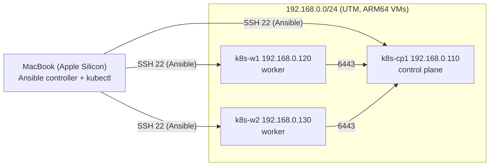

# kubeadm-cluster-lab

A self-managed Kubernetes cluster built from scratch with kubeadm on three CentOS Stream 10 VMs, with SELinux enforcing and firewalld running on every node. No minikube, kind or managed services. Node preparation is automated with Ansible, and each milestone is documented with its design decisions and evidence from real runs.

The project is also preparation for the Certified Kubernetes Administrator (CKA) exam.

## Status

| Milestone | Scope | Status |
|---|---|---|
| 1. Node preparation | Ansible role: time sync, swap, kernel modules, sysctls, firewalld, containerd, pinned kube packages | Complete |
| 2. Bootstrap | `kubeadm init`, worker joins, what kubeadm creates | Planned |
| 3. Networking | Calico CNI, MetalLB, Gateway API | Planned |
| 4. Storage | NFS server, csi-driver-nfs dynamic provisioning | Planned |
| 5. Workloads | Deployment, Postgres StatefulSet, RBAC-limited user, NetworkPolicy | Planned |
| 6. Observability | Grafana Alloy to Prometheus, Loki and Grafana | Planned |
| Failure drills | Node loss, control plane loss, etcd restore, rollback, upgrade, certificate renewal | Planned |

## Architecture



The diagram grows with each milestone. Milestone-specific diagrams live in `docs/`.

## Environment

| Item | Value |
|---|---|
| Host | MacBook, Apple Silicon, 36 GB RAM, UTM |
| Nodes | 3 VMs, CentOS Stream 10 (EL10, kernel 6.12, aarch64), 2 vCPU and 4 GB RAM each |
| Kubernetes | 1.36.4 from pkgs.k8s.io |
| Container runtime | containerd (containerd.io package), systemd cgroup driver |
| Pod CIDR / Service CIDR | 10.244.0.0/16 / 10.96.0.0/12 |
| CNI (milestone 3) | Calico, native BGP routing, no encapsulation |
| Security baseline | SELinux enforcing, firewalld running |

## Repository structure

```text
kubeadm-cluster-lab/
├── README.md
├── ansible.cfg
├── requirements.yml              # Ansible collections
├── inventory/
│   ├── hosts.yml                 # control_plane and workers groups
│   └── group_vars/all.yml        # versions, CIDRs, firewall ports
├── playbooks/
│   ├── node-prep.yml
│   └── verify-node-prep.yml
├── roles/
│   └── node_prep/                # milestone 1 role
├── scripts/
│   ├── run.sh                    # session logging helper
│   └── verify-node-prep.sh       # per-node acceptance checks
├── docs/
│   └── milestone-1-node-prep.md
├── logs/                         # recorded session logs
└── screenshots/
```

## Quick start

From the repository root on the Mac:

```bash
brew install ansible
ansible-galaxy collection install -r requirements.yml
ansible k8s_cluster -m ansible.builtin.ping

ansible-playbook playbooks/node-prep.yml
ansible-playbook playbooks/verify-node-prep.yml
```

Details, expected results and troubleshooting: [docs/milestone-1-node-prep.md](docs/milestone-1-node-prep.md).

## Key design decisions

- **SELinux and firewalld stay on.** The role refuses to run on a host without SELinux enforcing, and opens only the ports each node role needs. The pod CIDR is a trusted firewalld source so firewalld does not drop traffic that Calico's rules allow.
- **Pod CIDR 10.244.0.0/16.** Calico's default pool, 192.168.0.0/16, overlaps the node network.
- **Pinned Kubernetes packages.** The pkgs.k8s.io repository's `exclude` line keeps `dnf upgrade` away from kubelet, kubeadm and kubectl; upgrades happen deliberately with kubeadm.
- **CentOS Stream 10.** Stream is the development branch that RHEL 10 minor releases are cut from, so packages update continuously rather than in point releases. The nodes are effectively a preview of RHEL 10; a production cluster would run RHEL 10 or a rebuild such as Rocky or AlmaLinux 10.
- **One source of truth.** Versions, CIDRs and firewall ports live in `inventory/group_vars/all.yml` and are reused by later milestones.

## References

- kubeadm installation: https://kubernetes.io/docs/setup/production-environment/tools/kubeadm/install-kubeadm/
- Kubernetes ports and protocols: https://kubernetes.io/docs/reference/networking/ports-and-protocols/
- Calico system requirements: https://docs.tigera.io/calico/latest/getting-started/kubernetes/requirements

## TL;DR

Three CentOS Stream 10 VMs become a kubeadm Kubernetes cluster with SELinux enforcing and firewalld on. Milestone 1 is an Ansible role (`ansible-playbook playbooks/node-prep.yml`) that synchronises the clock, disables swap, loads kernel modules, sets sysctls, opens firewall ports, installs containerd with the systemd cgroup driver and installs pinned Kubernetes 1.36.4 packages. `playbooks/verify-node-prep.yml` proves every node is ready for `kubeadm init`.
