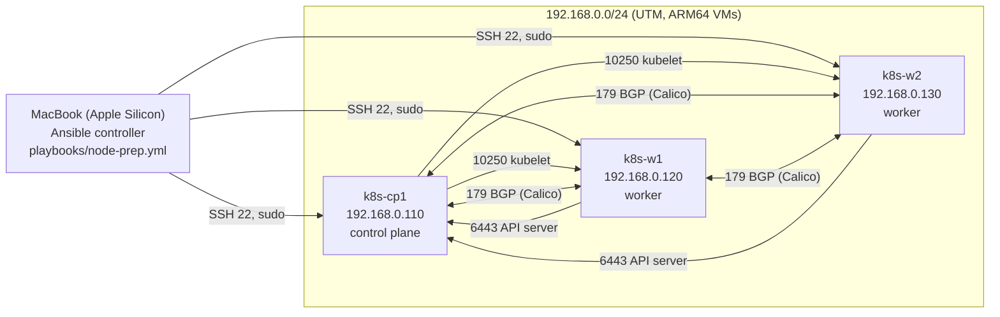
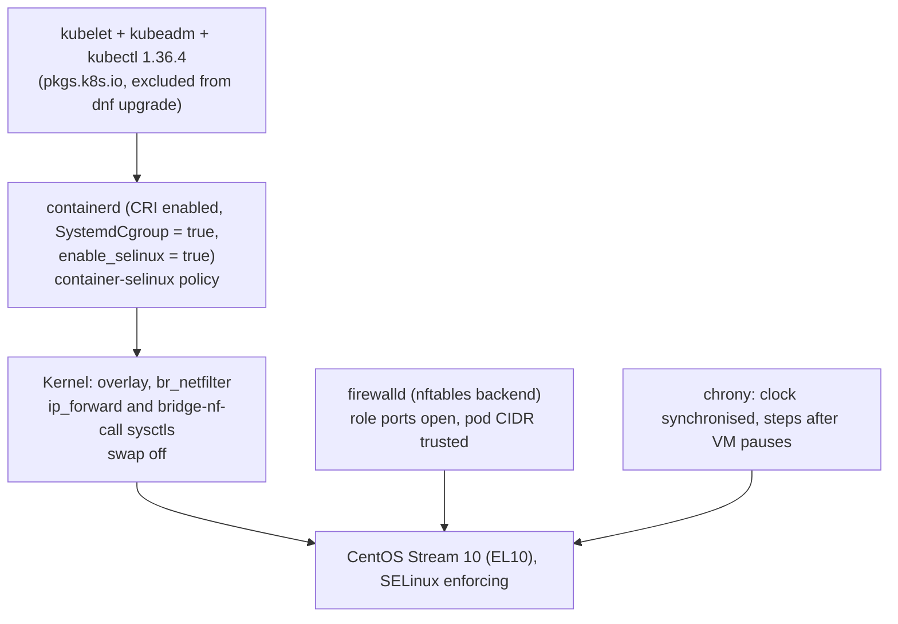

# Milestone 1: Node preparation with Ansible

The `node_prep` role takes three CentOS Stream 10 VMs to the point where `kubeadm init` and `kubeadm join` pass their preflight checks, with SELinux enforcing and firewalld running throughout.

## Architecture



The SSH arrows are what this milestone uses. The node-to-node arrows are the paths the firewall is opened for now, so that milestones 2 and 3 work without revisiting firewalld.

Each node ends up with this stack:



## What the role does

| Task file | Change | Why |
|---|---|---|
| `preflight.yml` | Fails unless the host is CentOS Stream 10 with SELinux enforcing | The role never weakens SELinux; it refuses to run instead |
| `time.yml` | Installs chrony, sets `makestep 1 -1`, waits until the clock is synchronised | Certificates, tokens and repository TLS depend on correct time; paused VMs resume behind |
| `hosts.yml` | Sets the hostname, writes every node into `/etc/hosts` | kubeadm uses the node name in certificates and Node objects |
| `swap.yml` | `swapoff -a`, comments swap lines out of `/etc/fstab` | kubelet memory accounting and eviction assume no swap; kubeadm preflight fails with swap on |
| `kernel.yml` | Loads `overlay` and `br_netfilter` now and at boot, then sets three sysctls | overlayfs stacks image layers; bridged traffic must pass netfilter; pod traffic is forwarded |
| `packages.yml` | Installs conntrack-tools, socat, iproute-tc, iptables-nft, container-selinux | Tools kubeadm preflight looks for, plus the SELinux policy for containers |
| `firewalld.yml` | Opens per-role ports, trusts the pod CIDR | Keeps firewalld on without it dropping pod traffic |
| `containerd.yml` | Installs containerd.io, rebuilds `config.toml`, configures crictl | Enables CRI, the systemd cgroup driver and SELinux labelling of containers |
| `kubernetes.yml` | Adds the pkgs.k8s.io 1.36 repo, installs pinned packages and cri-tools, enables kubelet | Exact, reproducible versions that only change on purpose |

The modules task runs before the sysctl task on purpose: the `net.bridge.*` keys do not exist until `br_netfilter` is loaded.

## Design decisions

**CentOS Stream 10 (EL10).** The VMs run CentOS Stream 10 with kernel 6.12. Stream is the branch RHEL 10 minor releases are built from, so it updates continuously and runs slightly ahead of RHEL. On these nodes `overlay` and `br_netfilter` ship in the base kernel package, and `iptables-nft` and `container-selinux` are already installed. EL10 leans further toward nftables than EL9, which feeds into the kube-proxy mode choice in milestone 2.

**Kubernetes 1.36.4, not 1.37.** One minor version behind the newest release leaves room for the kubeadm upgrade drill. pkgs.k8s.io has one repository per minor version, so the upgrade later means changing the repository URL as well as the package version.

**Pod CIDR 10.244.0.0/16.** Calico's default pod pool is 192.168.0.0/16, which contains the node network 192.168.0.0/24. Pods and nodes would share address space and routing would break. The value lives in `inventory/group_vars/all.yml` and milestone 2 reads the same variable for `kubeadm init`.

**Calico native routing (BGP) without encapsulation.** All three nodes share one layer 2 segment, so each node can route pod traffic straight to the node that owns the destination pod block. Only TCP 179 is opened. Switching `calico_routing_mode` to `vxlan` opens UDP 4789 instead.

**firewalld stays on.** Calico's system requirements recommend disabling firewalld because it can interfere with Calico's rules. On EL10, firewalld, kube-proxy and Calico all program nftables in separate tables. A packet traverses every table attached to the same hook: an accept in one table only ends that table, while a drop in any table is final. The pod CIDR is therefore added as a source of the `trusted` zone, so firewalld accepts pod-sourced traffic and Calico's rules (including NetworkPolicy in milestone 5) make the actual decision. Cross-node pod traffic is tested end to end in milestone 3.

**containerd.io from Docker's repository.** CentOS Stream does not package containerd; Docker's CentOS repository supports Stream 10. The `containerd.io` RPM ships a `config.toml` that disables the CRI plugin, which Kubernetes needs. The role regenerates the file from `containerd config default` on the node, so the plugin paths always match the installed containerd version (config version 3 on containerd 2.x), and changes two defaults: `SystemdCgroup = true`, and `enable_selinux = true`. An assertion stops the play if either key is missing.

**SELinux labelling of containers.** containerd's CRI plugin defaults to `enable_selinux = false`. With that default, containers are not given their own `container_t` label with unique MCS categories, so they run unconfined even though the host enforces SELinux. Turning it on gives each Pod its own label, which isolates containers from the host and from each other. The expected cost is that kubeadm's control-plane static Pods, which mount host paths such as `/var/lib/etcd` and `/etc/kubernetes/pki`, may need SELinux contexts or booleans adjusted in milestone 2.

**cri-tools installed explicitly.** The 1.36 kubeadm package does not depend on cri-tools, so `crictl` is not installed with it. The role installs cri-tools from the same pkgs.k8s.io repository, which only carries the matching minor version.

**systemd cgroup driver.** EL10 uses cgroup v2 only, with systemd managing the cgroup tree. containerd and the kubelet both use systemd as the cgroup driver so there is a single writer. kubeadm configures the kubelet for systemd by default.

**Time synchronisation with chrony, `makestep 1 -1`.** kubeadm signs certificates with a validity window that starts at the control plane's current time, and bootstrap tokens expire, so every node needs the correct time. These VMs pause when the Mac sleeps or UTM suspends them; during the build, k8s-cp1 resumed 34 hours behind. chrony's default `makestep 1.0 3` only steps the clock during the first three updates after chronyd starts and slews afterwards, at a rate that would take years to close a gap that size. `makestep 1 -1` lets chronyd step whenever the offset exceeds 1 second. Stepping can surprise software that measures intervals, which is why production servers usually keep the default; here it is the right trade for VMs that pause. The role waits for synchronisation with `chronyc waitsync` before installing anything over TLS.

**Package pinning with the repository `exclude` line.** This is the method in the official kubeadm install guide. `dnf upgrade` skips kubelet, kubeadm, kubectl, cri-tools and kubernetes-cni; the role installs them with `disable_excludes: kubernetes`.

## Prerequisites

On the Mac (controller):

```bash
brew install ansible
ansible-galaxy collection install -r requirements.yml
```

On each VM:

- CentOS Stream 10, SELinux enforcing, reachable on 192.168.0.110, .120 and .130
- The Mac's SSH public key in `/root/.ssh/authorized_keys` on each node (EL10's sshd allows root login with a key, not with a password, by default): `ssh-copy-id root@192.168.0.110` and the same for .120 and .130

Check connectivity from the repository root:

```bash
ansible k8s_cluster -m ansible.builtin.ping
```

## Running the milestone

All commands run on the Mac, from the repository root.

```bash
source scripts/run.sh milestone-1-node-prep

run ansible-inventory --graph
run ansible-playbook playbooks/node-prep.yml --syntax-check
run ansible-playbook playbooks/node-prep.yml
run ansible-playbook playbooks/node-prep.yml
run ansible-playbook playbooks/verify-node-prep.yml
```

The second run of `node-prep.yml` is the idempotence check.

Check mode (`--check --diff`) is useful on later runs, once the repositories and packages exist. On a fresh node it cannot predict much, because tasks that depend on a repository or package that check mode did not actually install will fail.

## Expected results

- First run: `changed` on every node, `failed=0`.
- Second run: `changed=0 failed=0` on every node.
- Verification: every line `PASS`, ending with `40 passed, 0 failed` on k8s-cp1 and `36 passed, 0 failed` on each worker (workers do not open the four control-plane ports).
- `systemctl status kubelet` shows `enabled` and `inactive (dead)`. The role enables kubelet but does not start it. If kubelet is started, or the node reboots, it shows `activating (auto-restart)` instead: it exits because `/var/lib/kubelet/config.yaml` does not exist yet, and `Restart=always` starts it again. Both states are correct until `kubeadm init` or `kubeadm join` writes its configuration in milestone 2.

## Troubleshooting

| Symptom | Cause | Check |
|---|---|---|
| `sysctl: cannot stat /proc/sys/net/bridge/bridge-nf-call-iptables` | `br_netfilter` not loaded when the sysctl was applied | `lsmod \| grep br_netfilter`; the role orders modules before sysctls |
| `No match for argument: kubeadm-1.36.4` | The `exclude` line hides the package, or the version does not exist in the repo | `dnf list --showduplicates kubeadm --disableexcludes=kubernetes` |
| `crictl info` fails with `unknown service runtime.v1.RuntimeService` | CRI plugin disabled, usually the packaged `config.toml` | `grep disabled_plugins /etc/containerd/config.toml` |
| Assertion `SystemdCgroup or enable_selinux was not found` | containerd's default config layout changed | `containerd config default \| grep -n -i -e cgroup -e selinux` |
| `crictl: command not found` | cri-tools not installed; kubeadm does not pull it in | `rpm -q cri-tools` |
| Port checks fail but firewalld is running | The node's interface is bound to a zone other than `public` | `firewall-cmd --get-active-zones` |
| Wrong date on a node, or `x509: certificate has expired or is not yet valid` | Clock behind after the VM was paused | `date -u` and `chronyc tracking`; `chronyc makestep` steps it now |
| `Wait for the clock to synchronise` times out | chronyd cannot reach a time source | `chronyc sources`: at least one source marked `*` |
| SSH `Permission denied` or host key prompt | Key not copied or host not yet in `known_hosts` | `ssh root@192.168.0.110` once per node |

## Evidence

Captured in one recorded session (`logs/<timestamp>-milestone-1-node-prep.log`):

| Screenshot | Shows |
|---|---|
| `screenshots/01-node-prep-idempotent.png` | Play recap of the second run with `changed=0` |
| `screenshots/02-node-prep-verify.png` | Verification output, all checks passing |
| `screenshots/03-kubelet-waiting.png` | kubelet enabled and waiting for kubeadm |

## References

- Installing kubeadm: https://kubernetes.io/docs/setup/production-environment/tools/kubeadm/install-kubeadm/
- Container runtimes (cgroup drivers, containerd): https://kubernetes.io/docs/setup/production-environment/container-runtimes/
- Ports and protocols: https://kubernetes.io/docs/reference/networking/ports-and-protocols/
- Changing the Kubernetes package repository: https://kubernetes.io/docs/tasks/administer-cluster/kubeadm/change-package-repository/
- containerd CRI configuration: https://containerd.io/docs/2.3/cri/config/
- Calico system requirements: https://docs.tigera.io/calico/latest/getting-started/kubernetes/requirements
