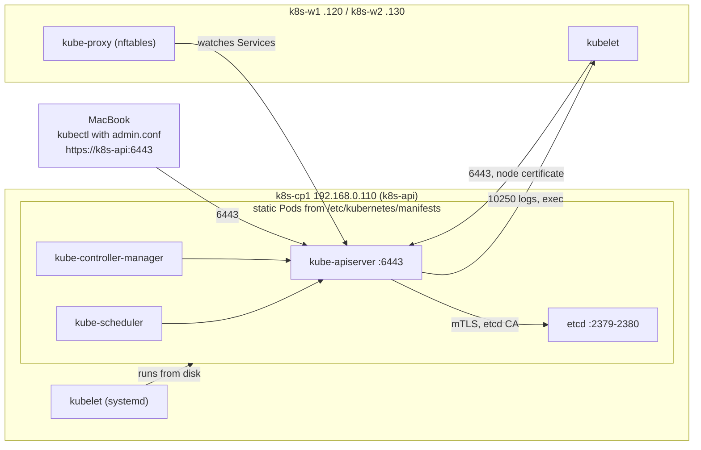

# Milestone 2: Bootstrap the cluster with kubeadm

`kubeadm init` turns k8s-cp1 into a control plane from a configuration file in this repository, and `kubeadm join` adds k8s-w1 and k8s-w2. Nodes stay `NotReady` until a CNI is installed in milestone 3; that is expected and explained below.

## Architecture



The control plane runs as static Pods: the kubelet on k8s-cp1 starts them from files on disk, with host networking, so the API server can run before any API server or CNI exists. Workers talk only to the API server.

## What kubeadm creates on k8s-cp1

| Path | Contents | Purpose |
|---|---|---|
| `/etc/kubernetes/pki/ca.{crt,key}` | Cluster CA, 10 years | Signs API server, kubelet and admin identities |
| `/etc/kubernetes/pki/etcd/ca.{crt,key}` | etcd CA | Only certificates from this CA can talk to etcd, which holds every Secret |
| `/etc/kubernetes/pki/front-proxy-ca.{crt,key}` | Front proxy CA | Trust for API aggregation, kept apart from the cluster CA |
| `/etc/kubernetes/pki/apiserver.crt` | API server serving certificate, 1 year | SANs include `k8s-api`, `k8s-cp1`, `192.168.0.110`, `10.96.0.1` and `kubernetes.default.svc.cluster.local` |
| `/etc/kubernetes/pki/sa.{key,pub}` | Key pair | Signs and verifies ServiceAccount tokens |
| `/etc/kubernetes/admin.conf` | Group `kubeadm:cluster-admins` | Day-to-day admin; cluster-admin through RBAC, so it can be revoked |
| `/etc/kubernetes/super-admin.conf` | Group `system:masters` | Bypasses RBAC; emergency use only, never copied off the node |
| `/etc/kubernetes/{controller-manager,scheduler,kubelet}.conf` | Component identities | Each component authenticates with its own certificate |
| `/etc/kubernetes/manifests/*.yaml` | Four static Pod manifests | etcd, kube-apiserver, kube-controller-manager, kube-scheduler |
| `/var/lib/kubelet/config.yaml`, `kubeadm-flags.env` | Kubelet configuration | Ends the kubelet restart loop seen in milestone 1 |

In the cluster it creates the `kubeadm-config` and `kubelet-config` ConfigMaps, the `cluster-info` ConfigMap in `kube-public`, a bootstrap token Secret, the control-plane label and `NoSchedule` taint on k8s-cp1, and the CoreDNS Deployment and kube-proxy DaemonSet.

## How workers join

1. The worker downloads `cluster-info` from `kube-public` without credentials.
2. It hashes the CA public key and compares it with `--discovery-token-ca-cert-hash`, which proves it reached the real cluster.
3. It authenticates with the bootstrap token and submits a CertificateSigningRequest for `system:node:<name>`.
4. The controller-manager approves and signs it; the kubelet writes `/etc/kubernetes/kubelet.conf` and registers the Node.

The token proves the worker to the cluster; the CA hash proves the cluster to the worker. After joining, the Node authorizer limits each kubelet to objects tied to its own node.

## Design decisions

**Configuration file, not flags.** `kubeadm/kubeadm-config.yaml` (kubeadm API `v1beta4`) holds the InitConfiguration, ClusterConfiguration, KubeletConfiguration and KubeProxyConfiguration. It is reviewable, reproducible and reused by the upgrade drill. Its values match `inventory/group_vars/all.yml`; the Ansible version of this milestone will template it from those variables.

**`controlPlaneEndpoint: k8s-api:6443`.** The endpoint is written into the API server certificate SANs and every kubeconfig. A name that resolves to k8s-cp1 through `/etc/hosts` today can later point at a kube-vip address for the HA stretch goal without reissuing certificates or kubeconfigs. Using `192.168.0.110` directly would make that change a rebuild. In this milestone the entry is added by hand to `/etc/hosts` on every node and on the Mac; it moves into the `node_prep` role when the milestone is automated.

**kube-proxy in nftables mode.** EL10 favours nftables, the iptables tooling is deprecated there, and the nftables backend is the upstream direction. Calico supports clusters with kube-proxy in nftables mode through its own nftables data plane, and the two must match, so milestone 3 installs Calico with the nftables data plane.

**Short-lived bootstrap tokens, kept out of the evidence.** `kubeadm init` runs with `--skip-token-print`, and its token expires after an hour instead of the default 24. The join command is generated on k8s-cp1 with a 15 minute token, pasted into each worker, and the token is deleted with `kubeadm token delete` as soon as both workers have joined. No screenshot shows a token, and none is committed to Git.

**Pod and Service subnets.** `10.244.0.0/16` and `10.96.0.0/12`, as decided in milestone 1. The pod subnet must match Calico's pool in milestone 3.

**Manual first, Ansible later.** Every step of this milestone runs by hand in a shell on the VM it applies to, including the `/etc/hosts` entry for `k8s-api`, so every phase's output and every created file can be inspected. Nothing in this milestone runs through Ansible; automating it comes after the manual run is understood.

## SELinux: control plane runs as spc_t

containerd labels containers (`enable_selinux = true`), so every container runs as `container_t` with its own MCS category pair. The first `kubeadm init` stopped at `wait-control-plane` because all four static Pods crashed on SELinux denials:

```
denied { read } comm=kube-apiserver name=sa.key
  scontext=system_u:system_r:container_t:s0:c141,c651
  tcontext=unconfined_u:object_r:kubernetes_file_t:s0 tclass=file
```

The controller-manager and scheduler were denied their kubeconfigs in the same way, and etcd logged `open /var/lib/etcd: permission denied`. container-selinux labels `/etc/kubernetes` as `kubernetes_file_t` so that ordinary containers cannot read the cluster's keys and kubeconfigs; `/var/lib/etcd` is `var_lib_t`, which `container_t` cannot open either.

| Option | Effect |
|---|---|
| Run the four control plane static Pods as `spc_t` (chosen) | The control plane, which already holds the cluster CA, runs unconfined. Every workload stays `container_t`, and `/etc/kubernetes` stays `kubernetes_file_t`, so a Pod cannot read the CA keys even through a hostPath mount |
| Relabel `/etc/kubernetes` and `/var/lib/etcd` as `container_file_t` | Any container with a hostPath mount could read `ca.key` and `super-admin.conf` |
| Policy module allowing `container_t` to read `kubernetes_file_t` | Same exposure as relabelling, for every container, plus a local module to maintain |

The fix is a kubeadm patch per component in `kubeadm/patches/` (`etcd.yaml`, `kube-apiserver.yaml`, `kube-controller-manager.yaml`, `kube-scheduler.yaml`), each a strategic merge of:

```yaml
spec:
  securityContext:
    seLinuxOptions:
      type: spc_t
```

`patches.directory` in the InitConfiguration points kubeadm at them, and kubeadm merges them into the static Pod manifests before writing them. `kubeadm upgrade` regenerates the manifests, so the upgrade drill must pass the same patches directory. SELinux stays enforcing throughout.

## Expected results

- `kubeadm config validate` reports no errors.
- `kubeadm init` ends with `Your Kubernetes control-plane has initialized successfully!`.
- `kubectl get nodes` on k8s-cp1 (and later from the Mac) lists k8s-cp1, k8s-w1 and k8s-w2, all `NotReady`, version `v1.36.4`.
- `kubectl get pods -n kube-system`: etcd, kube-apiserver, kube-controller-manager and kube-scheduler `Running` on k8s-cp1; three kube-proxy Pods `Running`; two CoreDNS Pods `Pending`.
- `kubectl get csr`: worker node certificates `Approved,Issued`.
- kube-proxy ConfigMap shows `mode: nftables`, and `nft list tables` on each node lists `table ip kube-proxy`.
- Control plane processes run as `spc_t` (`ps -eZ`), and `ausearch` reports no new denials after `init`.

`NotReady` and `Pending` are correct at this stage: the kubelet reports `NetworkReady=false` until a CNI writes its configuration to `/etc/cni/net.d`, and CoreDNS needs a pod IP.

## Troubleshooting

| Symptom | Likely cause | Check |
|---|---|---|
| `kubeadm config validate` rejects a field | Field name or API version wrong for kubeadm 1.36 | `kubeadm config print init-defaults` for the expected shape |
| Preflight warning about the sandbox (pause) image | containerd's `sandbox` image differs from the one kubeadm expects | `kubeadm config images list` and `containerd config dump \| grep sandbox` |
| `init` hangs at `wait-control-plane` | A static Pod crashing: SELinux denial (patches not applied), bad flag, port in use | `crictl ps -a`, `crictl logs <id>`, `ausearch -m AVC -ts recent -i` |
| `x509: certificate is valid for ..., not k8s-api` | Name missing from the API server SANs | `openssl x509 -in /etc/kubernetes/pki/apiserver.crt -noout -ext subjectAltName` |
| Mac `kubectl`: `no such host k8s-api` | Mac `/etc/hosts` entry missing | `grep k8s-api /etc/hosts` |
| Join fails with `token id ... is invalid` | Token expired or mistyped | Generate a fresh one with `kubeadm token create --ttl 15m --print-join-command` |
| Join times out connecting to `k8s-api:6443` | Worker cannot resolve the name, or port 6443 blocked | `getent hosts k8s-api` and `nc -zv k8s-api 6443` on the worker |

## Evidence

All screenshots are taken from k8s-cp1's terminal.

| Screenshot | Shows |
|---|---|
| `screenshots/04-kubeadm-init.png` | `kubeadm init` completing successfully |
| `screenshots/05-control-plane-files.png` | PKI, kubeconfigs and static Pod manifests on k8s-cp1 |
| `screenshots/06-nodes-notready.png` | Three nodes `NotReady` and the kube-system Pods |
| `screenshots/07-kube-proxy-nftables.png` | kube-proxy running in nftables mode |

## References

- kubeadm init (phases and workflow): https://kubernetes.io/docs/reference/setup-tools/kubeadm/kubeadm-init/
- kubeadm implementation details: https://kubernetes.io/docs/reference/setup-tools/kubeadm/implementation-details/
- kubeadm configuration (v1beta4): https://kubernetes.io/docs/reference/config-api/kubeadm-config.v1beta4/
- PKI certificates and requirements: https://kubernetes.io/docs/setup/best-practices/certificates/
- Calico with nftables: https://docs.tigera.io/calico/latest/getting-started/kubernetes/nftables
