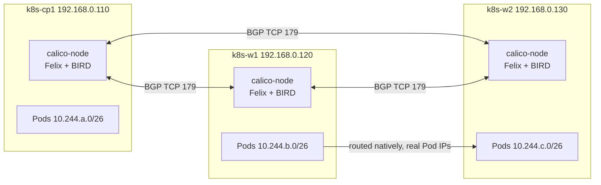

# Milestone 3a: Pod networking with Calico

Calico 3.33 gives every Pod an IP from `10.244.0.0/16`, routes Pod traffic between nodes with BGP and no encapsulation, and enforces NetworkPolicy with its nftables data plane. Installing it turns all three nodes `Ready` and lets CoreDNS start.

## Architecture



Each calico-node runs BIRD, which peers with the other two nodes over BGP and announces the node's Pod blocks. Every node installs a route per remote block (`10.244.b.0/26 via 192.168.0.120 proto bird`), so Pod packets cross the LAN unencapsulated with their real source and destination IPs. Felix, in the same Pod, programs the local `/32` Pod routes and the nftables rules for NetworkPolicy and NAT.

## Components

| Component | Runs as | Job |
|---|---|---|
| Tigera operator | Deployment, `tigera-operator` namespace | Reads the `Installation` resource and creates and reconciles everything below |
| calico-node | DaemonSet, `hostNetwork` | Felix (routes, nftables policy and NAT) and BIRD (BGP); installs the CNI plugin and config |
| CNI plugin and calico-ipam | `/opt/cni/bin`, `/etc/cni/net.d` | Called by containerd per Pod sandbox: creates the `cali*` veth pair and assigns the Pod IP |
| calico-kube-controllers | Deployment | Garbage-collects Calico state for deleted Nodes and Pods |
| calico-typha | Deployment | Caches API server data for calico-node instances |
| Calico API server | Deployment | Serves `projectcalico.org/v3` resources (IP pools, BGP, Calico policies) to `kubectl` |

## Configuration

`calico/custom-resources.yaml`:

| Setting | Value | Why |
|---|---|---|
| `linuxDataplane` | `Nftables` | kube-proxy runs in nftables mode (milestone 2), and Calico's nftables data plane is the one compatible with it |
| `bgp` | `Enabled` | BIRD distributes Pod routes between nodes |
| `nodeAddressAutodetectionV4` | `kubernetes: NodeInternalIP` | BGP peers on each node's Kubernetes InternalIP (`192.168.0.1x0`), not whichever interface is found first |
| `ipPools[0].cidr` | `10.244.0.0/16` | Matches kubeadm's `podSubnet`; the docs' example `192.168.0.0/16` contains the node LAN |
| `blockSize` | `26` | Each node is handed blocks of 64 addresses as it needs them |
| `encapsulation` | `None` | All nodes share one layer 2 segment, so Pod packets are routed natively; no VXLAN or IP-in-IP overhead or MTU reduction |
| `natOutgoing` | `Enabled` | Pod traffic leaving the Pod network is source-NATed to the node IP so replies from the LAN or internet find their way back |
| `APIServer` resource | `default` | Lets `kubectl` manage Calico resources directly |

## Design decisions

**Tigera operator rather than the single `calico.yaml` manifest.** The operator is the documented install path for the nftables data plane, reconciles Calico from one `Installation` resource, and turns upgrades into an operator upgrade.

**Native routing with BGP.** Decided in milestone 1, when TCP 179 was opened between nodes. Pod traffic keeps its real source IP end to end, which NetworkPolicy relies on in milestone 5.

**NetworkManager leaves Calico's interfaces alone.** NetworkManager manages routes for interfaces in the host network namespace, which is where Calico's `cali*` veth ends live. `/etc/NetworkManager/conf.d/calico.conf` (repository copy: `calico/networkmanager-calico.conf`) marks `cali*`, `tunl*`, VXLAN and WireGuard devices as unmanaged so NetworkManager cannot rewrite Calico's routes. It is created by hand on each node in this milestone and moves into the `node_prep` role when the milestones are automated.

**firewalld stays on.** Calico needs TCP 179 (BGP) and TCP 5473 (Typha) open between nodes. Felix's nftables tables sit beside `inet firewalld` and `ip kube-proxy`. An accept in one nftables table ends only that table, while a drop in any table is final, so firewalld trusts the Pod CIDR as a source (milestone 1). Cross-node Pod traffic is tested explicitly below to prove that arrangement.

**SELinux stays enforcing.** calico-node is a privileged container; Pods such as CoreDNS run as `container_t` with their own MCS categories. Both are checked with `ps -eZ` and `ausearch` after the install.

## Findings from the install

**Typha needs TCP 5473 between nodes.** After the install, calico-node on k8s-cp1 stayed `0/1` and restarted on its startup probe. Its log showed `dial tcp 192.168.0.120:5473: connect: no route to host` for both Typha endpoints, so confd never wrote `bird.cfg`, BIRD never started, and the probe failed with `unable to connect to BIRDv4 socket`. `no route to host` from a reachable LAN host is firewalld rejecting the connection with an ICMP prohibited message. Milestone 1 opened 179 for BGP but not 5473 for Typha, which the operator always deploys. The workers were unaffected because each connected to the Typha on its own node over the loopback path; k8s-cp1 runs no Typha and had to cross the LAN. Fix: `firewall-cmd --permanent --zone=public --add-port=5473/tcp` and a reload on every node, since Typha can be scheduled anywhere. calico-node recovered without a restart once the port opened.

**The Tigera operator could not read `/var/lib/calico/mtu`.** `tigerastatus` reported `calico` degraded with `error reading network MTU: open /var/lib/calico/mtu: permission denied`. The directory is `drwxr-xr-x` and the file world-readable, so Unix permissions were not the cause. The denial was logged on k8s-w1, the node running the operator:

```
denied { read } comm=operator name=mtu
  scontext=system_u:system_r:container_t:s0:c681,c948
  tcontext=system_u:object_r:container_var_lib_t:s0 tclass=file
```

`container_var_lib_t` is the container runtime's own state type, which confined containers cannot read. The operator runs confined as uid 10001; calico-node, which writes the file, runs as `spc_t`. The directory holds only the detected MTU, the node name and a shutdown timestamp, so it was relabelled for containers rather than making the operator unconfined:

```bash
semanage fcontext -a -t container_file_t '/var/lib/calico(/.*)?'
restorecon -Rv /var/lib/calico
```

This is the opposite of the milestone 2 decision for `/etc/kubernetes` because the data differs: that tree holds the cluster CA keys, this one holds no secrets. The `semanage` rule makes the label persistent across relabels; files calico-node rewrites inherit the directory's label.

## Verification

| Check | Expected |
|---|---|
| `kubectl get tigerastatus` | `calico` and `apiserver` `AVAILABLE True` |
| `kubectl get nodes` | All three nodes `Ready` |
| CoreDNS Pods | `Running`, with `10.244.x.x` IPs |
| `ip route` on each node | One `proto bird` route per remote node's block |
| `ss` on port 179 | Two established BGP sessions per node |
| Test Pod on k8s-w1 pinging a test Pod on k8s-w2 | Replies, by Pod IP |
| DNS from a Pod | `kubernetes.default.svc.cluster.local` resolves to `10.96.0.1` |
| `nft list tables` | Calico tables beside `inet firewalld` and `ip kube-proxy` |
| `ausearch -m AVC` | No denials |

## Troubleshooting

| Symptom | Likely cause | Check |
|---|---|---|
| calico-node `0/1 Ready`, BGP not established | TCP 179 blocked, or wrong node address detected | `ss -tn state established '( sport = :179 or dport = :179 )'`; `kubectl -n calico-system logs ds/calico-node -c calico-node \| grep -i bgp` |
| Pods stuck `ContainerCreating` | CNI binary or config missing, or IPAM failing | `kubectl describe pod <pod>`; `ls /etc/cni/net.d /opt/cni/bin` |
| Same-node Pods talk, cross-node Pods do not | Missing BGP routes, or firewalld dropping forwarded Pod traffic | `ip route \| grep bird`; `firewall-cmd --zone=trusted --list-sources`; `tcpdump -ni enp0s1 icmp` on both nodes |
| Pod IPs in `192.168.0.0/16` | `cidr` not changed from the docs' example | `kubectl get ippools -o wide` |
| Routes to `cali*` interfaces disappear | NetworkManager managing Calico's interfaces | `NetworkManager --print-config \| grep unmanaged-devices` |
| calico-node `0/1`, log shows `no route to host` to port 5473 | firewalld blocking Typha | `firewall-cmd --zone=public --list-ports` on every node |
| `tigerastatus`: `error reading network MTU ... permission denied` | Operator (`container_t`) denied `container_var_lib_t` | `ausearch -m AVC -i \| grep mtu` on the operator's node; `ls -lZ /var/lib/calico` |
| `ausearch` shows denials | A Calico component cannot reach a host path under its SELinux label | Stop and share the denials |

## Evidence

All screenshots are taken from k8s-cp1's terminal.

| Screenshot | Shows |
|---|---|
| `screenshots/08-calico-pods.png` | Calico components running and `tigerastatus` available |
| `screenshots/09-nodes-ready.png` | Three nodes `Ready`, CoreDNS running with Pod IPs |
| `screenshots/10-bgp-routes.png` | CNI config, BGP sessions and `proto bird` routes |
| `screenshots/11-cross-node-pods.png` | A Pod on k8s-w1 reaching a Pod on k8s-w2, and DNS from a Pod |
| `screenshots/12-nftables-selinux.png` | Calico nftables tables and SELinux labels |

## References

- Calico nftables install: https://docs.tigera.io/calico/latest/getting-started/kubernetes/nftables
- Calico IP pools and IPAM: https://docs.tigera.io/calico/latest/networking/ipam/get-started-ip-addresses
- Configure NetworkManager for Calico: https://docs.tigera.io/calico/latest/operations/troubleshoot/troubleshooting#configure-networkmanager
- Operator Installation API: https://docs.tigera.io/calico/latest/reference/installation/api
